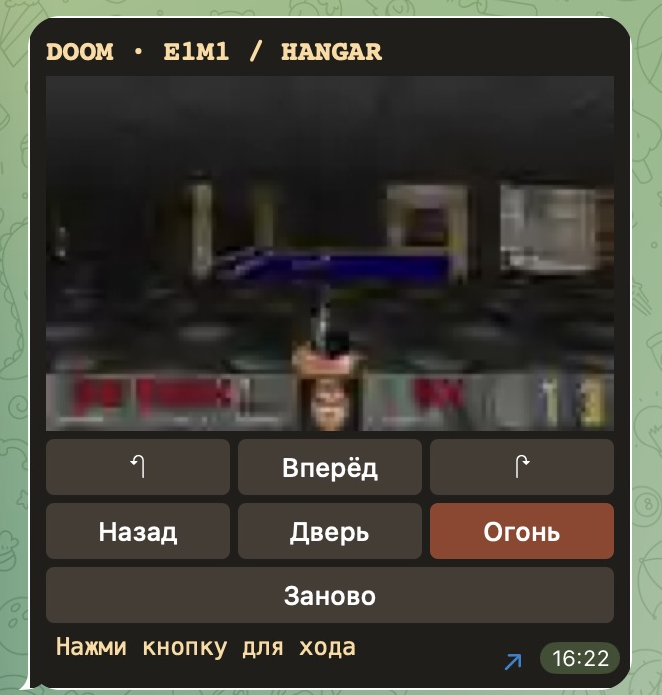
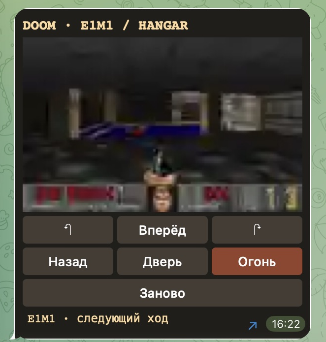
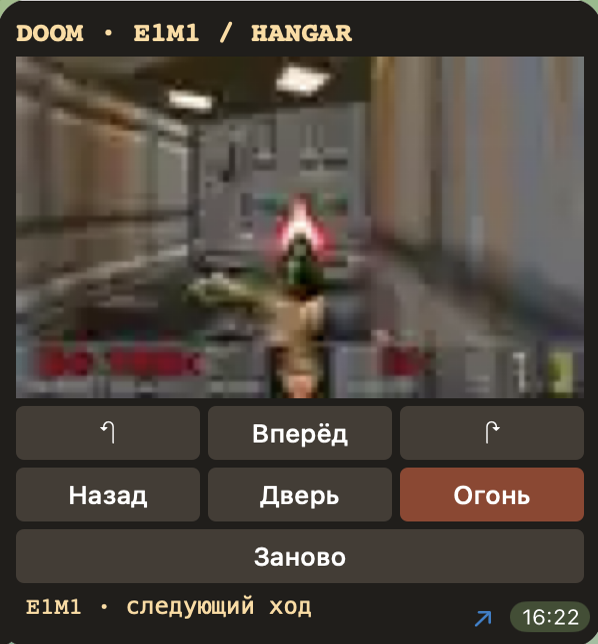
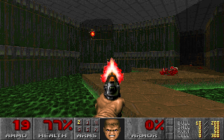
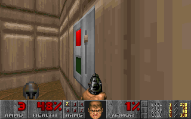

# Doom Message

**English** · [Русский](README.ru.md)

[Play Doom in Telegram](https://t.me/ADanManDoomMessageBot?start=hangar) · [Browse more Telegram widgets](https://github.com/ADanMan/awesome-telegram-widgets)

Play Hangar (E1M1) from the original Doom 1.9 shareware release inside a Telegram message. ViZDoom runs on the bot's host. Tap a button to move the game forward five ticks and see the next frame in the same message. The game pauses between turns.

## Playing in Telegram

Open the bot in a private chat and tap **Start**. Use the arrows to turn, **Forward** and **Back** to walk, **Use** to open doors or activate switches, and **Fire** to shoot. **Restart** takes you back to the start of Hangar. Controls default to English and switch to Russian for users with a Russian Telegram language setting.

 



These screenshots show the Russian interface in Telegram for macOS. We walked from the starting room to the door and fired the pistol in that client.

## A full run through Hangar

 

These two frames come from a local ViZDoom run, before Telegram frame compression. Using the same actions as the widget, the player reached the exit switch in 537 turns, killed six enemies and finished with 48% health.

## Run your own bot

You need Python 3.12, a Telegram bot token and the original Doom Shareware 1.9 `DOOM1.WAD` (MD5 `f0cefca49926d00903cf57551d901abe`). The game assets belong to id Software. Supply your own copy.

```sh
python3.12 -m venv .venv
.venv/bin/pip install -r requirements.txt
export DOOM_WAD=/path/to/DOOM1.WAD
# Set BOT_TOKEN in the environment or store it in ~/.config/doom-message/token with mode 0600.
.venv/bin/python bot.py
```

Send `/start` in a private chat with your bot. The host supports up to six game sessions and releases idle sessions after ten minutes. The widget has no sound or saved games.

## How a frame fits in a message

The widget sends the action name through `TelegramWidget.request`. The bot advances the game and returns a Base64-encoded WebP frame through `answerWidgetQuery`. The encoder adjusts the resolution to fit the 1,024-byte response limit. The widget waits just over one second between requests.

Play requires a running bot and a Telegram client with widget support. As of November 10, 2026, production widgets run in private bot chats. You can share the bot link in a public channel.

[Telegram Widgets](https://core.telegram.org/bots/widgets) · [ViZDoom](https://github.com/Farama-Foundation/ViZDoom)
