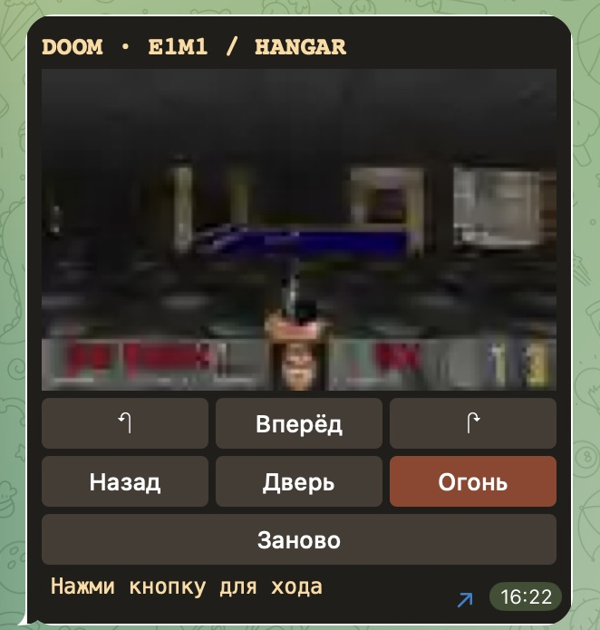
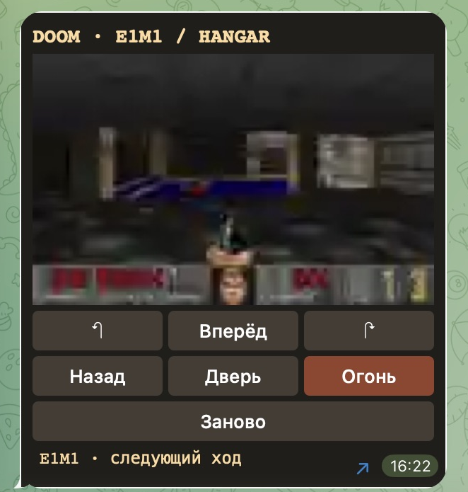
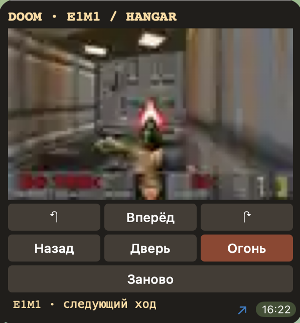
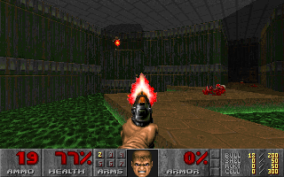
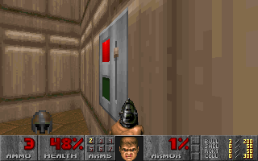

# Doom Message

[English](README.md) · **Русский**

[Играть в Telegram](https://t.me/ADanManDoomMessageBot?start=hangar)

Оригинальная shareware-версия Doom 1.9, уровень E1M1 (Hangar), с управлением прямо в сообщении Telegram. Игровую логику и графику обрабатывает ViZDoom на компьютере с ботом. Виджет показывает кадр и принимает нажатия. Каждый ход продвигает игру на пять игровых тиков. Между ходами мир стоит на паузе.

## Игра в Telegram для macOS

 



В том же клиенте удалось пройти от стартового зала до двери и выстрелить из пистолета.

## Бой и выход из ангара

 

Кадры выше сняты в локальном ViZDoom до сжатия для Telegram. В контрольном прохождении E1M1 игрок дошёл до выключателя, уничтожил шесть противников и завершил уровень с 48% здоровья. Прохождение заняло 537 ходов по пять тиков с теми же действиями, что доступны в виджете.

## Запуск

Понадобятся Python 3.12, токен отдельного Telegram-бота и оригинальный файл DOOM1.WAD из Doom Shareware 1.9. MD5 файла — `f0cefca49926d00903cf57551d901abe`. Игровые ресурсы принадлежат id Software и в репозиторий не входят.

```sh
python3.12 -m venv .venv
.venv/bin/pip install -r requirements.txt
export DOOM_WAD=/path/to/DOOM1.WAD
# Передайте BOT_TOKEN через окружение или сохраните токен в ~/.config/doom-message/token с правами 0600.
.venv/bin/python bot.py
```

Отправьте боту `/ru` в личке для русской версии. Команда `/start` открывает английскую. Поворот, шаг, огонь и открытие двери выполняются кнопками под кадром. «Заново» перезапускает E1M1. Звука и сохранений нет. Бот держит до шести игровых сессий и освобождает их после десяти минут бездействия.

## Как передаётся кадр

Виджет передаёт название действия через `TelegramWidget.request`. Бот исполняет действие и возвращает WebP в Base64 через `answerWidgetQuery`. Разрешение меняется с детализацией сцены, чтобы уложиться в 1024 байта ответа. Интервал между запросами — чуть больше секунды. Для игры нужны работающий бот, доступ к Telegram и клиент с поддержкой виджетов.

На 10 ноября 2026 года Telegram разрешает виджеты в продакшене только в личном чате с ботом. В публичном канале можно поделиться ссылкой на бота. [Telegram Widgets](https://core.telegram.org/bots/widgets) · [ViZDoom](https://github.com/Farama-Foundation/ViZDoom)
